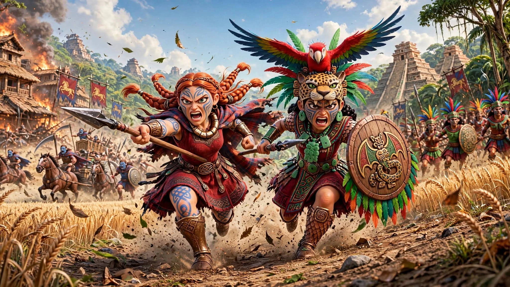
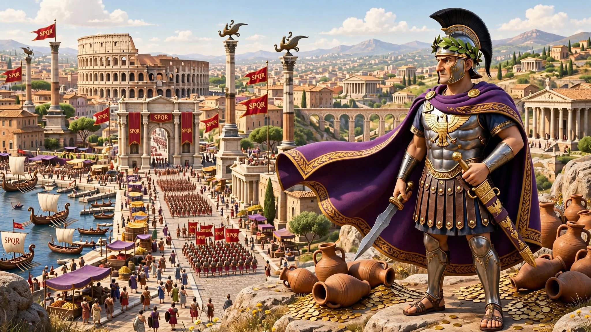
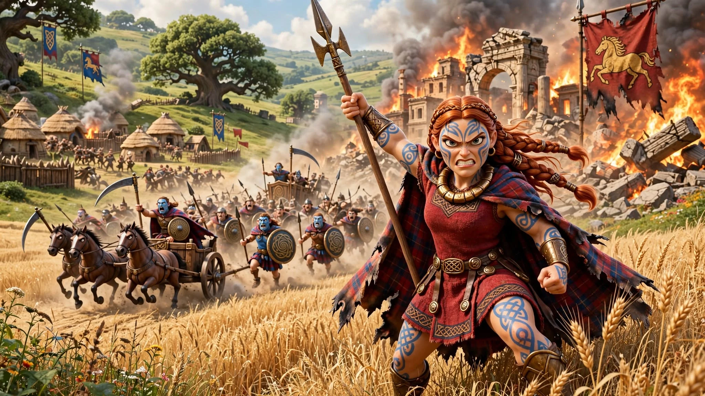

<p align="center">
  
</p>

<h1 align="center">Shadows of War</h1>

<p align="center">
  Real-time multiplayer strategy. Lead a historic figure, build cities, factories and ports,<br />
  make and break alliances, and take the map.
</p>

<p align="center">
  <a href="https://shadowsofwar.io/play/"><strong>Play</strong></a>
  · <a href="https://shadowsofwar.io/">Website</a>
  · <a href="https://discord.gg/4mBM6zJyG">Discord</a>
</p>

| World | Europe | Julius Caesar | Boudica campaign |
| --- | --- | --- | --- |
|  |  |  |  |

## Run locally

```bash
./sow        # native desktop client (Electron + WASM)
./sow l      # browser build at http://127.0.0.1:4173
./sow help   # all commands
```

Rust for the client, simulation, server and relay; TypeScript for the menu and site; Blade for rendering.

[Contributing](CONTRIBUTING.md) · [Security](SECURITY.md)

## License

Modified from OpenFrontIO since `2026-05-08`. © OpenFront and Contributors.

Code: [AGPL-3.0-only](LICENSE) with OpenFront's additional terms. OpenFront-derived maps: CC BY-SA 4.0
([notice](assets/maps/NOTICE)). Other assets: [LICENSE-ASSETS](docs/legal/LICENSE-ASSETS). Third-party:
[NOTICE](docs/legal/NOTICE).
