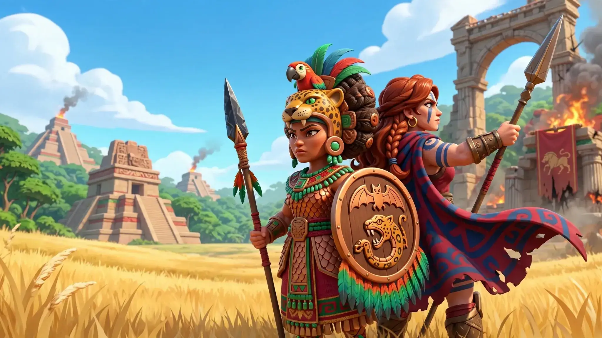
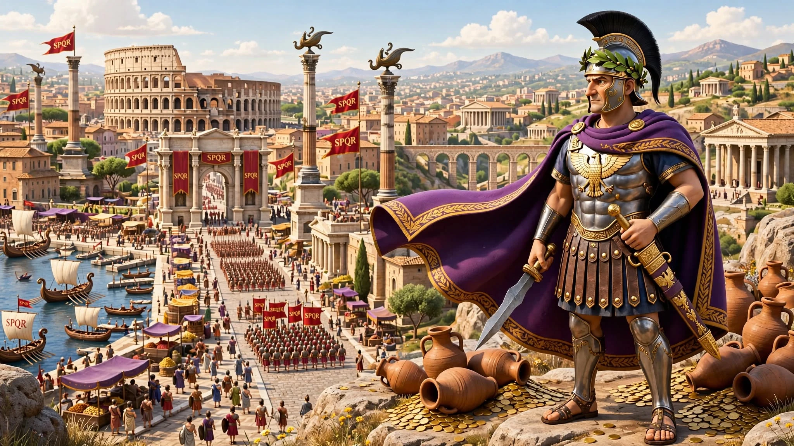
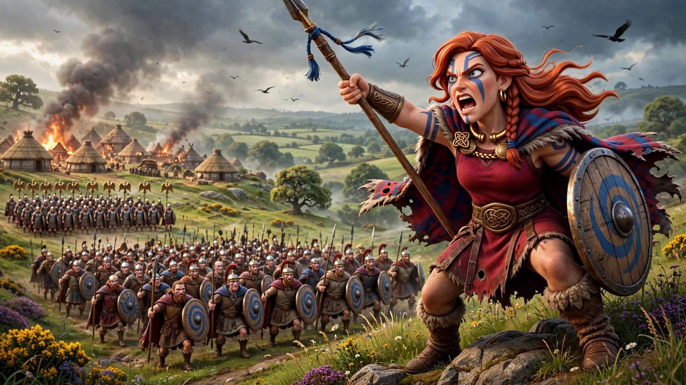

<p align="center">
  
</p>

<h1 align="center">Shadows of War</h1>

<p align="center">
  <strong>Command historic leaders in real-time territory wars.</strong><br />
  Build cities, factories and ports, forge alliances, betray rivals, and redraw the world map in this multiplayer game.
</p>

<p align="center">
  <a href="https://shadowsofwar.io/play/"><strong>▶ Play now</strong></a>
  · <a href="https://shadowsofwar.io/">Website</a>
  · <a href="https://discord.gg/d6ZDeChSE">Discord</a>
</p>

<p align="center">
  <a href="https://github.com/worldofunreal/shadows-of-war/blob/master/LICENSE"></a>
  
  
  
</p>

## The game


Shadows of War is a multiplayer strategy game about taking territory and turning it into power.

- Expand across the world map.
- Build cities, factories, ports and an economy that supports your wars.
- Choose a historic leader and play around their strengths.
- Forge alliances, betray rivals and fight for control of the map.
- Join online matches or play local battles against bots.

| Europe | Asia | Leaders | Campaign |
| --- | --- | --- | --- |
|  |  |  |  |

## Run locally

```bash
./sow          # build and open the native Tauri/WASM game
./sow l        # local browser preview at 127.0.0.1:4173
```

## Links

- [Play Shadows of War](https://shadowsofwar.io/play/)
- [Website](https://shadowsofwar.io/)
- [Contributing](CONTRIBUTING.md)
- [License](LICENSE)

## License & derivatives

**Modified from OpenFrontIO.** The in-game source link identifies the exact revision.

Game code is licensed under [AGPL-3.0-only](LICENSE), including OpenFront's additional terms. The main menu links to the exact source revision for AGPL section 13. OpenFront-derived maps use CC BY-SA 4.0; their attribution, source, and changes are in the [map notice](assets/maps/NOTICE), served alongside map files. Other asset and client dependency notices are in [LICENSE-ASSETS](docs/legal/LICENSE-ASSETS) and [NOTICE](docs/legal/NOTICE).
